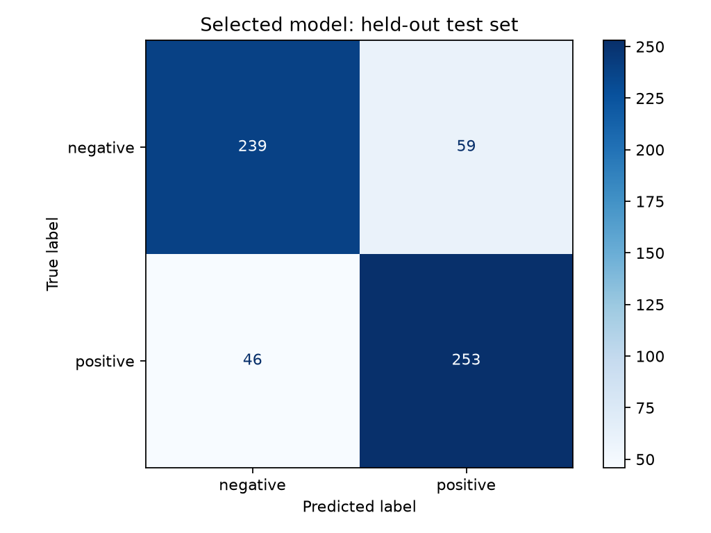
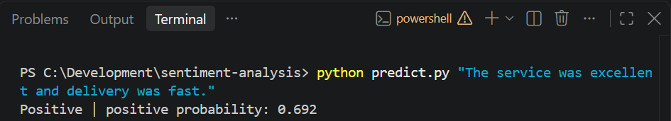
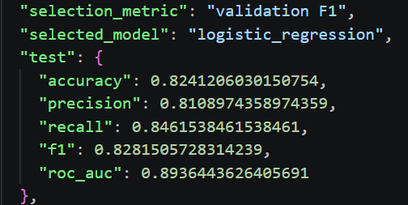

# Sentiment Analysis Across Three Review Domains

A reproducible sentiment analysis project that classifies English reviews as **positive** or **negative** using natural language processing and machine learning.

The project compares **TF-IDF + Logistic Regression** with **TF-IDF + a neural Multilayer Perceptron (MLP)**. Logistic Regression achieved the higher validation F1 score and was selected for final inference, achieving **82.41% held-out test accuracy**.

## Project Objective

Implement a sentiment analysis model on a new dataset, explore a neural network architecture, compare its performance with a conventional baseline, and save a reusable prediction pipeline.

The implementation covers:

- Dataset download and loading
- Data cleaning and duplicate removal
- Stratified training, validation, and test splits
- Text feature extraction using TF-IDF
- Baseline and neural network training
- Model selection using validation F1
- Evaluation on a held-out test set
- Model persistence and command-line inference

## Dataset

This project uses the **UCI Sentiment Labelled Sentences** dataset.

| Property | Details |
|---|---|
| Original size | 3,000 labeled sentences |
| Review sources | Amazon, IMDb, and Yelp |
| Sentiment classes | Negative and positive |
| Label encoding | `0` = Negative; `1` = Positive |
| Original source distribution | 1,000 sentences per source |
| Cleaned size | 2,982 sentences |
| License | Creative Commons Attribution 4.0 |

Dataset source: [UCI Machine Learning Repository](https://archive.ics.uci.edu/dataset/331/sentiment+labelled+sentences)

The training script downloads the original dataset archive automatically on its first run. The downloaded data is excluded from Git tracking.

## Data Cleaning and Splitting

The preprocessing procedure:

1. Combines the three review sources.
2. Removes rows with missing text or labels.
3. Removes leading and trailing whitespace.
4. Removes empty reviews.
5. Validates that labels are either `0` or `1`.
6. Removes texts that have conflicting sentiment labels.
7. Removes duplicate texts before splitting.

The cleaned dataset contains **2,982 reviews**, which is 18 fewer than the original dataset.

Splitting uses a fixed random seed of **42** and stratifies by both **review source and sentiment label**.

| Split | Reviews | Approximate share |
|---|---:|---:|
| Training | 1,908 | 64% |
| Validation | 477 | 16% |
| Test | 597 | 20% |

Removing duplicates before splitting prevents identical reviews from appearing in multiple splits.

## Text Representation

Both models use `TfidfVectorizer` to convert review text into numerical features.

Configuration:

- Word unigrams and bigrams
- Maximum of 10,000 features
- Minimum document frequency of 2
- Sublinear term-frequency scaling
- Unicode accent normalization
- Default lowercase conversion

Unigrams represent individual words, while bigrams represent consecutive word pairs. Bigrams can capture phrases such as “not good.”

The vectorizer is included inside each scikit-learn pipeline. During initial training, it is fitted only on the training split, preventing vocabulary and document-frequency leakage from validation or test data.

## Models

### Logistic Regression Baseline

A linear classifier trained on TF-IDF features.

Configuration:

- Maximum iterations: 1,000
- Random seed: 42

This baseline provides a comparison for assessing whether the neural network improves performance.

### Neural Multilayer Perceptron

A feedforward neural network trained on the same TF-IDF representation.

Configuration:

- One hidden layer with 64 neurons
- ReLU hidden-layer activation
- Adam optimizer
- L2 regularization parameter: `0.01`
- Early stopping enabled
- Maximum iterations: 100
- Early-stopping patience: 10 iterations without improvement
- Random seed: 42

The MLP learns nonlinear relationships between text features. Because its input is TF-IDF, it does not preserve full sentence order in the way that a recurrent network or transformer can.

## Model Selection

Both candidate models are initially trained on the training split and compared on the validation split.

**Validation F1** is the selection metric. The architecture with the higher validation F1 is then retrained on the combined training and validation data.

The held-out test split is used for final evaluation after model selection.

## Validation Results

Precision, recall, and F1 below refer to the positive class.

| Model | Accuracy | Precision | Recall | F1 | ROC-AUC |
|---|---:|---:|---:|---:|---:|
| Logistic Regression | 79.45% | 81.90% | 75.73% | 78.70% | 0.8807 |
| Neural MLP | 77.78% | 85.19% | 67.36% | 75.23% | 0.8548 |

**Selected model: Logistic Regression**

The MLP achieved higher positive-class precision, but lower recall. Logistic Regression achieved the higher F1 score and was therefore selected.

These results demonstrate that a neural network does not automatically outperform a simpler classifier.

## Held-Out Test Results

The selected Logistic Regression pipeline was evaluated on **597 test reviews**.

| Metric | Value |
|---|---:|
| Accuracy | 82.41% |
| Positive-class precision | 81.09% |
| Positive-class recall | 84.62% |
| Positive-class F1 | 82.82% |
| ROC-AUC | 0.8936 |
| Macro F1 | 82.40% |

### Per-Class Performance

| Class | Precision | Recall | F1 | Support |
|---|---:|---:|---:|---:|
| Negative | 83.86% | 80.20% | 81.99% | 298 |
| Positive | 81.09% | 84.62% | 82.82% | 299 |

### Confusion Matrix



The confusion matrix shows correct classifications and errors for both sentiment classes.

## Project Files

| File or folder | Purpose |
|---|---|
| `train.py` | Downloads data, cleans it, trains models, selects a model, and evaluates it |
| `predict.py` | Loads the saved pipeline and predicts sentiment for new text |
| `requirements.txt` | Required Python packages |
| `.gitignore` | Excludes downloaded data, virtual environments, and Python cache files |
| `outputs/metrics.json` | Split counts, model comparison, and final evaluation metrics |
| `outputs/confusion_matrix.png` | Test-set confusion matrix |
| `outputs/test_predictions.csv` | Test reviews, actual labels, predictions, and probabilities |
| `outputs/sentiment_model.joblib` | Saved selected model and TF-IDF vectorizer |
| `screenshots/` | Evidence of prediction and evaluation |
| `BeeNeural_Sentiment_Analysis_Report.pdf` | Project methodology, results, and limitations |

## Installation

Use Python 3.10 or later.

Clone the repository:

```bash
git clone https://github.com/Irha-Fatimaa/sentiment-analysis-three-review-domains.git
cd sentiment-analysis-three-review-domains
```

Create a virtual environment:

```bash
python -m venv .venv
```

Activate it in Windows PowerShell:

```powershell
.\.venv\Scripts\Activate.ps1
```

For macOS or Linux:

```bash
source .venv/bin/activate
```

Install dependencies:

```bash
python -m pip install -r requirements.txt
```

## Training

Run:

```bash
python train.py
```

The script downloads the dataset if needed, trains both candidates, prints the results, and saves artifacts in `outputs`.

Internet access is required for the first dataset download.

To use an existing dataset archive, place it at:

```text
data/sentiment_labelled_sentences.zip
```

Optional custom directories:

```bash
python train.py --cache data --output outputs
```

Exact results can vary with package versions and numerical libraries despite the fixed random seed.

## Predicting Sentiment

Run:

```bash
python predict.py "The service was excellent and delivery was fast."
```

Observed output:

```text
Positive | positive probability: 0.692
```

The model assigned the sentence a positive-class probability of approximately **69.2%**. This is a model estimate, not a guarantee of correctness.

A positive probability of at least `0.5` produces a positive prediction; otherwise the prediction is negative.

To specify another saved model:

```bash
python predict.py "Your review here." --model outputs/sentiment_model.joblib
```

Load only model files that you created or trust.

## Screenshots

### Prediction Example



### Evaluation Metrics



## Limitations

- The dataset is small and covers only three review domains.
- Performance on unrelated topics, longer reviews, or other languages is unverified.
- Sarcasm, ambiguity, and mixed sentiment can lead to errors.
- TF-IDF does not capture full sentence structure.
- Reported performance comes from one fixed split.
- The project provides command-line inference; it has not been deployed as a hosted production service.

## Future Improvements

- Evaluate additional neural architectures, such as LSTMs or transformers.
- Tune model hyperparameters using training and validation data.
- Measure training time and inference latency.
- Evaluate performance separately for each review source.
- Add an API or user interface for predictions.
- Use a fresh held-out evaluation set when making further model-selection decisions.

## Author

**Irha Fatima**

[GitHub Profile](https://github.com/Irha-Fatimaa)

## Dataset Attribution

Kotzias et al., *From Group to Individual Labels Using Deep Features*, KDD 2015.

Dataset provided through the UCI Machine Learning Repository under **CC BY 4.0**.